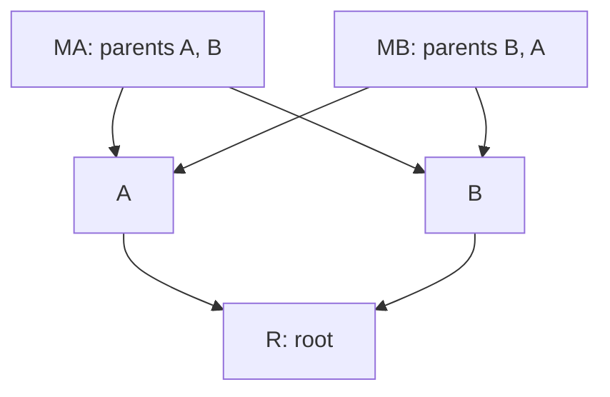

# Algorithms

The implementation uses standard containers and explicit loops. The important data structures are ordered maps for snapshots/commits, sets for sorted results, unordered sets for visited membership, vectors for iterative traversal stacks, and a flat vector for the diff DP table.

## SHA-256 content addressing

`ObjectStore::put` serializes a typed versioned envelope and computes SHA-256 through the vendored PicoSHA2 library. Its 64-character hexadecimal digest becomes the filename.

Consequences:

1. The same bytes and type serialize identically and share one object.
2. A change in content changes the ID with overwhelming probability.
3. Including type/version/lengths prevents confusing differently structured payloads.
4. Reading recomputes the hash before parsing, then validates the type, fields, and references.

SHA-256 is not encryption or authentication. Someone with write access can create different valid objects and modify refs; hash checks detect accidental corruption/substitution against an expected ID, not an authorized-looking malicious history.

For B serialized bytes, hashing is O(B) time. SHA itself can stream with constant internal state, but MiniGit deliberately loads each bounded object as a string, so this implementation uses O(B) space. No persistent ID uses `std::hash`.

Snapshots serialize a `std::map<string, string>` in sorted path order. Building a map of F paths requires O(F log F) map operations, plus path/string work. Serialization and hashing are linear in the actual encoded byte count. Path validation also walks every parent component to reject file/directory prefix collisions.

## Parent traversal and log

Parents point backward from a commit to its history. A root has no parents, an ordinary commit has one, and a merge has ours followed by theirs.

`loadHistory` starts with every referenced branch/merge tip. It repeatedly pops an ID, validates and stores its commit once, and pushes its parents. It also validates the referenced snapshots and blobs. `validateGraph` then uses an explicit DFS stack and three colors:

- Unseen: not examined.
- Active: on the current DFS path.
- Finished: all parents examined.

An edge to an active node is a cycle. An edge to a finished node is ordinary shared DAG ancestry. Missing nodes are errors. The explicit stack avoids dependence on the C++ call-stack depth.

`ancestors` includes the tip itself and follows **all** parents, with a set preventing repeat visits. Thus a commit on the second-parent side of a merge still counts as an ancestor.

`reachableOrder` implements log with a stack and an unordered visited set. It pushes parents in reverse so ours is popped first. Each commit prints once, regardless of how many paths reach it.

For example, if M has parents A and B, and both A and B have parent R, log shows `M, A, R, B`. R does not print again when B's ancestry is visited. This is deterministic first-parent-first DFS, not a graphical history or topological/date order.

With V commits and E parent edges, these traversals do O(V + E) visits. The implementation stores commits/colors/sorted ancestor results in ordered maps/sets, so its container cost is O((V + E) log V), plus string-key and object I/O costs. Visited unordered-set operations have expected O(1) membership cost. Traversal auxiliary space is O(V + E); valid stored commits have at most two parents, so E is at most 2V.

## Tree LCA versus DAG merge bases

Before merges, a single-root history with one parent per commit is a tree: each node has one route toward the root. Depth alignment or binary lifting can find a tree's lowest common ancestor.

After merges, there can be several routes backward and several incomparable best common ancestors. A single depth/parent array, timestamp comparison, or first shared BFS encounter does not solve the general DAG problem.

A **common ancestor** is reachable from both tips. A **best** common ancestor is not a strict ancestor of another common ancestor. There can be zero, one, or several best nodes.

### The actual algorithm

`bestCommonAncestors(graph, first, second)`:

1. Collect all ancestors of first and all ancestors of second, including the tips.
2. Intersect the sets to obtain common nodes C.
3. Start a multi-source traversal at every immediate parent of every node in C.
4. Follow parent edges with a shared visited set, marking all reached nodes dominated.
5. Return common nodes not marked dominated, already sorted by ID.

Why step 3 is correct: any node reached from a common node's parent is a strict ancestor of that common node. It therefore cannot be best. Conversely, every non-best common node is a strict ancestor of some other common node and will be reached by this traversal. Cycles were rejected, so a node cannot dominate itself through a cycle.

Sharing the visited set across all common nodes avoids repeating a full ancestor walk for every candidate. It does not select whichever shared node happens to be encountered first.

The algorithm performs a constant number of graph traversals/intersection steps, giving O((V + E) log V) container time here and O(V + E) auxiliary space. It does not use timestamps.

### A criss-cross example



For tips MA and MB, A and B are both common ancestors, and neither is an ancestor of the other. R is dominated by both. The result is both A and B, sorted by their IDs.

`merge-base` prints both. `merge` refuses automatic merging when the result has more than one node. Production systems can synthesize recursive virtual bases; this project explicitly does not implement that extra merge strategy.

The CLI tests construct this shape using actual branches and two merges. The C++ tests also compare 1,024 tip-pair results across all 64 four-node acyclic edge subsets against an independent Floyd-Warshall reachability definition. Abstract algorithm test graphs can have more parents than the storage format; stored commits remain limited to two.

## Safe deletion and merge cases

Branch deletion is allowed only if the branch's tip belongs to HEAD's ancestor set. Following all parents matters: a fully merged second-parent branch is safe to delete even if it is not on the first-parent chain.

For a clean merge of theirs into ours:

| Test | Meaning | Action |
| --- | --- | --- |
| Theirs is an ancestor of ours | Its history is already reachable | Report up to date. |
| Ours is an ancestor of theirs | No divergent commits need combining | Restore theirs, then advance only the current branch. |
| Neither, one best base | Divergence can be compared | Perform conservative three-way file comparison. |
| No best base | Unrelated roots | Refuse. |
| Several best bases | Criss-cross ambiguity for this implementation | Refuse before changing objects/files/state. |

These tests are ancestry relations, not timestamp guesses.

## LCS text diff

`Repository::diff` picks HEAD/index or index/working versions. `printTextDiff` first classifies binary data and checks byte/line/cell limits. It splits text into line strings **including newline bytes**, so `"a"` and `"a\n"` are different tokens.

For n old lines and m new lines, let DP[i,j] be the length of a longest common subsequence of the suffixes starting at i and j.

```text
DP[n,j] = 0
DP[i,m] = 0

if old[i] == new[j]:
    DP[i,j] = 1 + DP[i+1,j+1]
else:
    DP[i,j] = max(DP[i+1,j], DP[i,j+1])
```

The implementation fills the table from bottom right toward top left. It then walks from (0,0):

- Equal lines: emit a space-prefixed context line; advance both.
- Otherwise, if deleting can preserve an equally long or longer subsequence: emit `-`; advance old.
- Otherwise: emit `+`; advance new.

On a tie, deletion wins, making output deterministic. The display includes file/version headers and all context lines rather than implementing unified-diff hunks or patch application.

Example:

```text
old: a, b, a
new: a, a, c

output:
 a
-b
 a
+c
```

Empty-file creation/deletion gets an explicit message even though no line tokens exist. Missing final newlines are annotated. Binary differences produce a notice, never raw bytes.

There are (n+1)(m+1) DP cells. The table has O(nm) time in line comparisons and O(nm) space. Because actual line comparison uses `std::string`, its byte cost depends on line lengths; O(nm) assumes line equality is treated as one comparison, and a worst-case comparison can inspect L bytes. Tokenization/output adds linear work in text bytes.

The table uses 32-bit unsigned integers in a flat vector. Before allocation, division checks whether rows exceed `MAX_DIFF_CELLS / columns`, preventing product overflow. The limits are 1,000,000 cells (about 4 MiB), 1 MiB combined input, and 20,000 lines per side. Larger text gets an omission message. No working data is altered.

## Conservative three-way file comparison

For each path in the union of base, ours, and theirs, a version is either a blob ID or a special absent state represented internally by the empty string. An empty file has a real nonempty blob ID, so it differs from absence.

`compareThreeSnapshots` applies:

| Condition | Result |
| --- | --- |
| Ours equals theirs | Keep ours, including identical additions/deletions. |
| Ours equals base | Take theirs: only their side changed. |
| Theirs equals base | Keep ours: only our side changed. |
| Otherwise | Record a conflict. |

This handles independent files, one-sided additions/deletions, add/add, modify/modify, and modify/delete with the same rules. It compares complete file versions, not individual edited line ranges.

For text conflicts, the working file contains ours/theirs markers, with a deletion label for an absent side. For binary conflicts, it retains ours or absence. The index keeps ours for unresolved paths and stages unambiguous choices. Unresolved paths persist separately, so neither marker content nor a file's existence alone decides resolution.

Let P be the number of distinct paths and B the bytes loaded for conflicts/markers. The map/set work is O(P log P), plus path-prefix checks and O(B) byte work. Result maps consume O(P) entries; conflict contents are processed one path at a time with per-file size limits. Preflight and journaling impose an additional bounded sum of before/after bytes.

## Startup and safety costs

Per-algorithm costs above do not hide repository validation: each command loads the reachable graph and validates referenced snapshots and blobs. `loadHistory` now keeps a local set of successfully validated blob IDs across its distinct snapshots. `ObjectStore::getSnapshot` still checks every snapshot hash, type, format, path, and reference ID; it only omits a repeated blob read/hash after that blob passed hash/type/size validation in this pass. Failures never enter the set. A normal snapshot read has its own local set. Neither set persists in `ObjectStore` or across commands, so a changed object is checked again on the next command. Concurrent external mutation during one pass remains outside the cooperating immutable-filesystem assumption.

This adds O(U) ID storage for U distinct blobs in a history pass, avoiding repeated O(B) reads/hashes for the same B-byte blob in different snapshots. Snapshots/commits are still eagerly read, and separate validation passes within one command can still repeat work. No byte-content cache, persistent cache, or invalidation framework was added.

A bounded macOS arm64 measurement used a 4 MiB unchanged file shared by 20 distinct snapshots, each with a small changing counter. Three fresh `log` processes per build gave default medians 4.281 → 0.451 seconds and Release medians 0.400 → 0.073 seconds. See VALIDATION.md for all samples, toolchain, and commands. Both versions detected corruption between commands. This fixture demonstrates repeated validation cost and a local improvement; it is not a production-scale benchmark.

Filesystem transition planning examines every touched path and relevant obstructing directory. The scratch layout performs filesystem operations for each destination and its parents. Checking directory obstructions against removable paths uses straightforward loops; it is not optimized for large repositories. Journal space is linear in touched paths and exact before/after byte totals, with a hard 64 MiB cap.

Immutable object writes before ref publication can leave unreachable objects after failure. That preserves previous history without needing multi-object rollback; garbage collection is an exercise rather than an implemented feature.

## Path names, shell arguments, and journal integrity

A filesystem-object identity does not identify a directory entry: hard links have equal identities and different names. `resolvePath` prioritizes an exact filename; for non-exact case/Unicode spelling it accepts only one equivalent entry, refusing ambiguity. No lowercasing or Unicode normalization is guessed in application code; filesystem lookup supplies the alias behavior.

`display` is a readable escaping function, whereas `quoteShellArgument` preserves one literal POSIX shell argument. Both run in O(P) time/space for P path bytes. Shell single quotes disable substitutions, and a literal single quote is emitted by briefly leaving that quoted region. The application prints commands but never executes a shell.

The transaction v2 checksum hashes the complete serialized journal payload in O(J) time for J bytes. Serialization/parsing still uses bounded strings and the 64 MiB whole-record cap. Verify before rollback or cleanup; a malformed or unchecksummed legacy journal is preserved. Checksums detect corruption, and cannot authenticate content against a writer who can also replace the digest.
